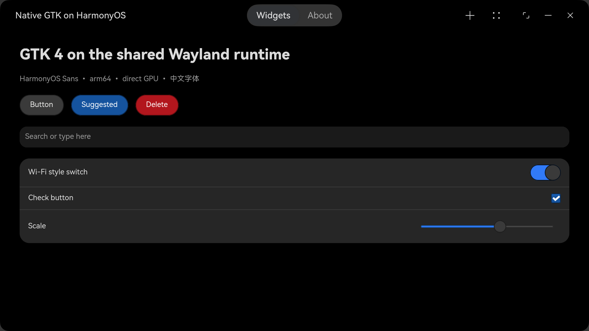
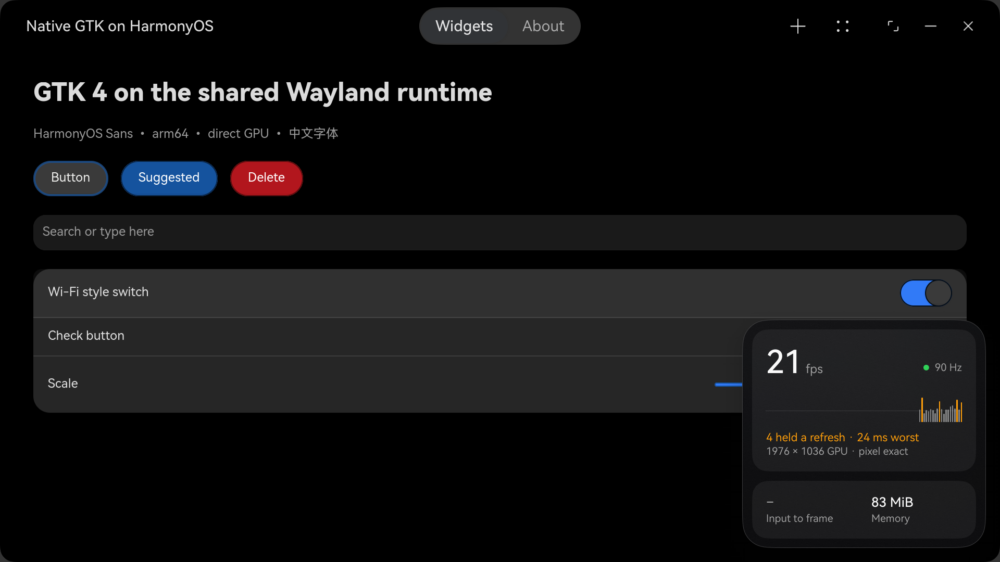

# ohos-wayland

ohos-wayland runs Linux Wayland apps on a HarmonyOS PC as ordinary HarmonyOS apps, drawn by the device's own GPU. There is no VM, X server, remote desktop, or streaming.

Each HAP contains a Wayland compositor, Mesa, and one app's files. The app renders through Zink and Huawei's Vulkan driver, and it presents into its own HarmonyOS window.

This repository contains the shared runtime, the `ohos_wl.py` packager, the native title bar protocol and GTK bridge, and a testing bottle. Apps arrive as prebuilt binaries, and the runtime and packager need no app-specific patches.



## Why this exists

HarmonyOS PCs have a capable GPU, but Linux desktop apps had no direct way to reach it.

- The openEuler VM measured on a MateBook Fold has no GPU device attached, so its apps have no hardware rendering.
- Forwarding from a container, as [lohg](https://github.com/luyanaa/lohg) does, reaches the GPU by sending windows and GL commands over TCP.
- Terminals such as [Termony](https://github.com/TermonyHQ/Termony) run command-line programs, not Wayland apps.

This project set one rule from the start: an app runs on the device, renders on the GPU, and appears in a real HarmonyOS window. The first target was Ghostty, which needs desktop OpenGL.

## What you get

- **Native GPU rendering.** Apps draw on the GPU through the system driver. On a MateBook Fold, both an in-process client and a separately executed one report `zink Vulkan 1.2(Maleoon 916 (ARM_PROPRIETARY))`.
- **Desktop OpenGL.** Zink supplies the desktop OpenGL that Linux apps expect, on top of Vulkan.
- **Unmodified Linux binaries.** Stock aarch64 musl programs from Alpine Linux run from the HAP's private native package. Ghostty, Alacritty, `weston-simple-egl`, ripgrep, Node, and `ssh` run with no patches. A patched Zed build, which is not in this repository, also runs in process.
- **A real HarmonyOS app for each program.** Each app has its own HAP and window. GTK 4 header bars become native HarmonyOS title bars, and buttons and menus keep their GTK actions. A maximized window keeps the native title bar at the top, and a bottle can choose a hover overlay with `titlebarMode`.
- **Shared input and data.** Keyboard, mouse, touch, touchpad scrolling, clipboard, and HarmonyOS drag and drop use the same runtime path in every app.
- **Live measurements.** Press **Ctrl+Alt+Shift+D** to show presentation rate, frame pacing, input latency, buffer geometry, and memory use.



## How frames reach the screen

Both kinds of app render on the GPU. They differ in how a finished frame reaches the window, because an executed program cannot receive a HarmonyOS window handle.

| App kind | Examples | Cost per frame after rendering |
| --- | --- | --- |
| Library loaded in the app's process | `gl-demo`, the Zed build | No frame copy |
| Stock executable | Ghostty, `weston-simple-egl` | One GPU copy and one CPU copy, off the app's render thread |

On a 120 Hz MatePad Edge, stock `weston-simple-egl` runs at 117 to 120 fps at 2090x1324, and the copy takes 2.7 to 2.9 ms per frame. [The architecture document](docs/architecture.md#presenting-from-another-process) describes both paths.

## Status

Version 0.1.0 is early. It has run on a MatePad Edge and a MateBook Fold, both with Maleoon GPUs. The device tests pass on the Fold, except `user-dirs`, which stalls under a borrowed signing bundle. The steps below have not yet been run from a clean clone, so open an issue if one fails.

Bottles for Ghostty, Alacritty, and Zed are not in this repository. The testing bottle includes `weston-simple-egl` and ripgrep, and [Add an app](#add-an-app) shows how to package your own.

## Requirements

You need these tools on a HarmonyOS PC in free-window mode:

- HarmonyOS 7 with API 26 and a Vulkan driver that exposes `VK_OHOS_surface`.
- HiShell and Harmonybrew. The build scripts install their own dependencies with `brew`.
- The HarmonyOS command-line tools, including the SDK, `hvigor`, and `hdc`.
- `devecocli` and `oniro-app`. Oniro signs debug profiles for CN, SG, EU, and RU accounts.
- A Huawei developer account. Each user signs HAPs with their own debug profile.
- Python, Meson, Ninja, pkg-config, patchelf, binutils, OpenJDK 21, Node, `librsvg`, Rust, and Cargo.

Set the paths for your installation. Replace the example HDC address with your device's address.

```sh
export TOOL_HOME=/path/to/command-line-tools
export COMMAND_LINE_TOOL_PATH="$TOOL_HOME"
export HDC="$TOOL_HOME/sdk/default/openharmony/toolchains/hdc"
export OHOS_WL_DEVICE=127.0.0.1:40417
export DEVECOCLI=/path/to/devecocli
export ONIRO=/path/to/oniro-app
```

## Build and run the testing app

Run every command from this directory in HiShell.

1. Fetch the pinned external sources and apply the patch series. This step is idempotent.

	```sh
	sh app/scripts/fetch_sources.sh
	```

2. Build the shared GPU and GTK libraries.

	```sh
	mkdir -p build/logs
	sh app/scripts/build_gpu.sh > build/logs/gpu-build.log 2>&1
	sh app/scripts/build_gtk.sh > build/logs/gtk-build.log 2>&1
	python3 app/scripts/stage_gtk.py > build/logs/stage.log 2>&1
	```

3. Build the testing probes.

	```sh
	sh tools/wl-gl-probe/build.sh
	sh tools/shm-probe/build.sh
	sh tools/syscall-probe/build.sh
	sh tools/scroll-probe/build.sh
	sh tools/hover-probe/build.sh
	sh tools/tls-probe/build-musl.sh
	```

4. Build the shared runtime.

	```sh
	python3 app/scripts/ohos_wl.py runtime
	```

5. Sign in to AppGallery Connect once.

	```sh
	oniro-app auth login
	```

	The first HAP build asks for a bundle prefix. Use a prefix that belongs to your developer account. The packager generates missing debug profiles and caches them in `~/.ohos-wl/signing`.

6. Package, sign, and install the testing app. Then run its device tests.

	```sh
	python3 app/scripts/ohos_wl.py bottle testing
	python3 app/scripts/ohos_wl.py hap testing
	python3 app/scripts/ohos_wl.py install testing
	python3 app/scripts/ohos_wl.py test
	```

	Every test prints `PASS` or `FAIL`. Run one test with `python3 app/scripts/ohos_wl.py test gtk-demo`.

	`hover-probe` is a manual check for real pointer delivery. It can request input-injection authorization. The default test suite does not run it.

## Add an app

Create `apps/<name>/bottle.json`. Start with a prebuilt aarch64 musl binary from Alpine Linux. List its packages, executables, data directories, and launch settings. [The bottle reference](docs/bottle-reference.md) documents every field.

Run the inner loop to package, sign, install, and start the app.

```sh
python3 app/scripts/ohos_wl.py dev <name>
```

Fix compatibility problems in the runtime, compositor, launcher, or packager. Do not add app-specific branches. Check each fix on at least two apps or on an app and a test.

## Inspect an app

- `python3 app/scripts/ohos_wl.py run <name>` starts an app.
- `python3 app/scripts/ohos_wl.py stop <name>` closes it.
- `python3 app/scripts/ohos_wl.py screenshot <name> --window` captures only its HarmonyOS window, including the native title bar.
- `python3 app/scripts/ohos_wl.py screenshot <name>` captures its next composed client frame.
- Program output goes to hilog and to `cache/ohos_wl_<app id>.log` in the app sandbox.

## Source-only releases

GitHub releases contain source code only. They contain no HAPs or prebuilt runtime archives. HarmonyOS requires each user to sign HAPs with a debug profile that belongs to that user's developer account.

## Known limits

- An app may execute `/system/bin` programs and programs in its own native package. Bottle every helper the app starts.
- Stock executables copy presented images into host-owned window buffers. In-process clients do not copy frames.
- Zink reports OpenGL 4.0 on the Maleoon. The runtime overrides the version to 4.3 because Ghostty and wgpu require it, so features beyond 4.0 can be missing. Mesa also warns that the driver lacks some base Zink requirements, so some rendering can be wrong.
- Only the newest toplevel and its popups appear. A second window from the same app is not presented.
- The first buffer after a window handoff can fail `OH_NativeImage_UpdateSurfaceImage` with `60002000`. An app that draws once and then waits may stay blank.
- Native title bars cover GTK 4. A header bar with a custom popover or an unknown widget falls back to a styled GTK header bar.
- A hover title bar does not animate in step with the status bar, because no HarmonyOS window API reports the status bar.
- Other devices and GPUs are untested and need runtime verification.

## Repository layout

| Path | Contents |
| --- | --- |
| `app/` | The runtime template HAP and build scripts. |
| `app/scripts/ohos_wl.py` | The runtime and app packager. |
| `apps/testing/` | The testing bottle and input fixtures. |
| `tools/` | Probe programs for device tests. |
| `protocols/` | The native title bar protocol. |
| `patches/` | Patch series for platform libraries. |
| `docs/` | Architecture, title bar design, and the bottle reference. |
| `evidence/` | Reviewed app-window captures. |

## Licence

Licences follow the code's origin by directory. WineHua-derived runtime code is LGPL-2.1-only. Project-owned packager, tools, bottles, documents, and new runtime files are MIT. Generated protocol code and patch series keep their upstream licences.

See `REUSE.toml`, `LICENSES/`, and `NOTICE` for the exact assignments and credits.
